# Решение задания

1. [Установка ОС](#part-1-установка-ос)  
2. [Создание пользователя](#part-2-создание-пользователя)  
3. [Настройка сети ОС](#part-3-настройка-сети-ос)   
4. [Обновление ОС](#part-4-обновление-ос)  
5. [Использование команды  sudo](#part-5-использование-команды-sudo)  
6. [Установка и настройка службы времени](#part-6-установка-и-настройка-службы-времени)  
7. [Установка и использование текстовых редакторов](#part-7-установка-и-использование-текстовых-редакторов)  
8. [Установка и базовая настройка сервиса SSHD](#part-8-установка-и-базовая-настройка-сервиса-sshd)   
9. [Установка и использование утилит top, htop](#part-9-установка-и-использование-утилит-top-htop)   
10. [Использование утилиты fdisk](#part-10-использование-утилиты-fdisk)   
11. [Использование утилиты df](#part-11-использование-утилиты-df)    
12. [Использование утилиты du](#part-12-использование-утилиты-du)    
13. [Установка и использование утилиты ncdu](#part-13-установка-и-использование-утилиты-ncdu)    
14. [Работа с системными журналами](#part-14-работа-с-системными-журналами)     
15. [Использование планировщика заданий CRON](#part-15-использование-планировщика-заданий-cron)  

## Part 1. Установка ОС

##### Установить **Ubuntu 20.04 Server LTS** без графического интерфейса. (Используем программу для виртуализации - VirtualBox)


- Была установленна программа VirtualBox
    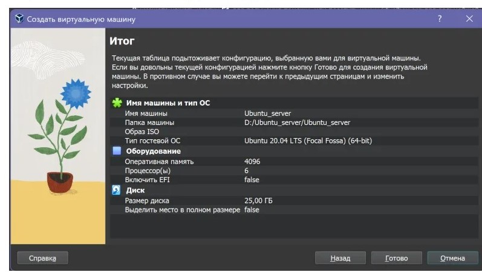

- Результат выполнения команды `cat /etc/issue`:
    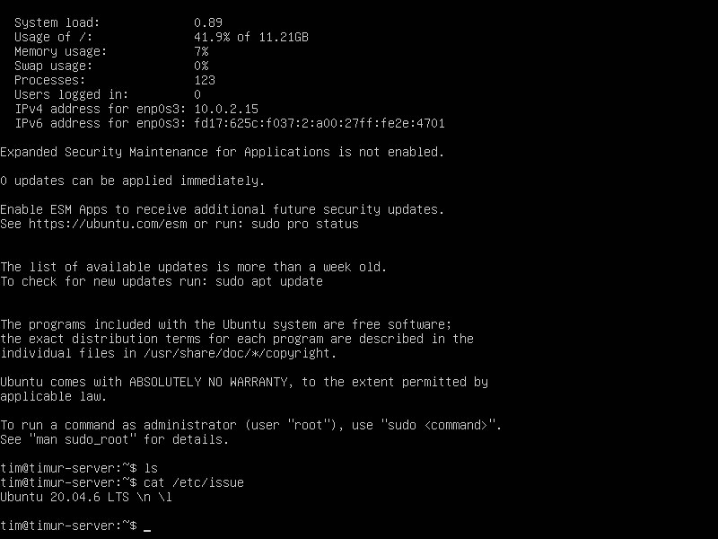

## Part 2. Создание пользователя

- Создадим нового пользователя `newuser` с помощью команды:
    ```
    sudo adduser newuser
    ```

    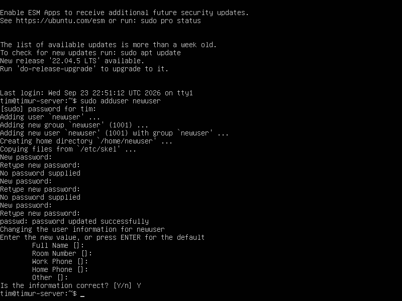

- Добавим нового пользователя `newuser` в группу `adm` с помощью команды:
    ```
    sudo usermod -a -G adm newuser
    ```

    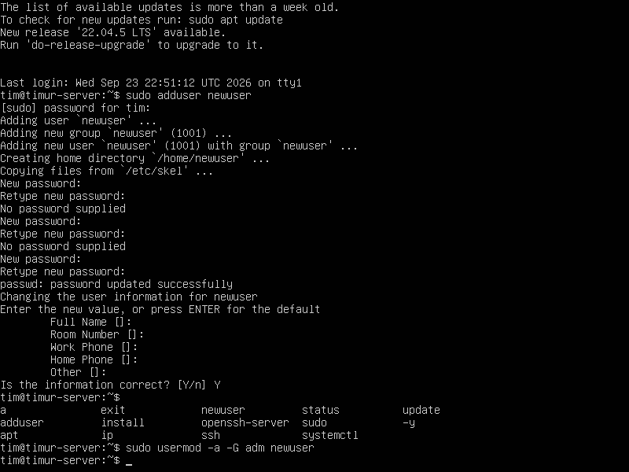

- Новый пользователь присутствует в выводе команды
`cat /etc/passwd`

    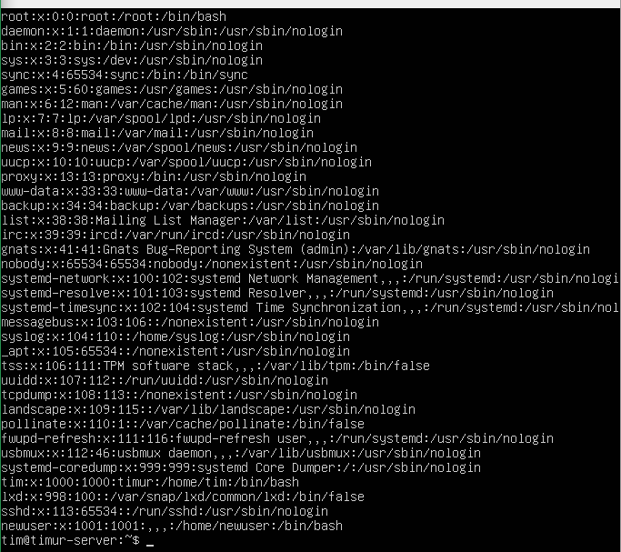


## Part 3. Настройка сети ОС

- С помощью команды `hostname` выясним, что при установке ОС машине было задано задано название `arzimanoffserver`. 

    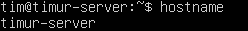

- Зададим новое название машины: `user-1`; с помощью команды:
    ```
    sudo hostname user-1
    ```
- После выполнения этой команды проверим текущее название командой `hostname`

    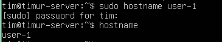

- Чтобы после `reboot` машины, выставленное ранее название не сбросилось, воспользуемся командой:
    ```
    sudo hostnamectl set-hostname user-1
    ```

    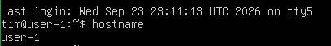

- После повторной перезагрузки, наименование машины не изменится.

---

- Чтобы узнать какая временная зона установлена на данный момент можно воспользоваться командой `date`. Данная временная зона не соответствует текущему местоположению:

    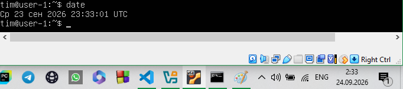

- Для изменения часового пояса на требуемый Europe/Moscow, используем команду:
    ```
    sudo timedatectl set-timezone Europe/Moscow
    ```

    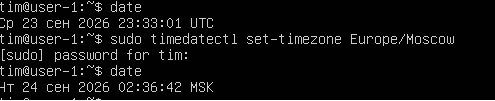

- Повторная проверка текущей временной зоны, выполненная с помощью команды `date`, показала актуальные значения.
---

- Вывести названия сетевых интерфейсов с помощью консольных команд:
    ```
    ip l
    ```
    ```
    ip address
    ```
    ```
    ls /sys/class/net
    ```

    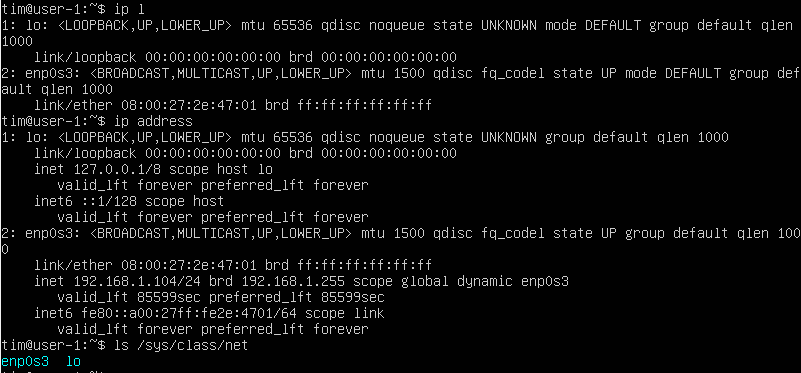

- >lo (loopback device) – виртуальный интерфейс, присутствующий по умолчанию в любом Linux. Он используется для отладки сетевых программ и запуска серверных приложений на локальной машине. С этим интерфейсом всегда связан адрес 127.0.0.1. У него есть dns-имя – localhost. Интерфейс lo является локальной петлёй. Она предназначена для обеспечения сетевого доступа к компьютеру.

---

- Чтобы узнать ip адрес машины, выданный ей DHCP сервером воспользуемся командой:
    ```
    cat /var/log/syslog | grep -i dhcp
    ```

    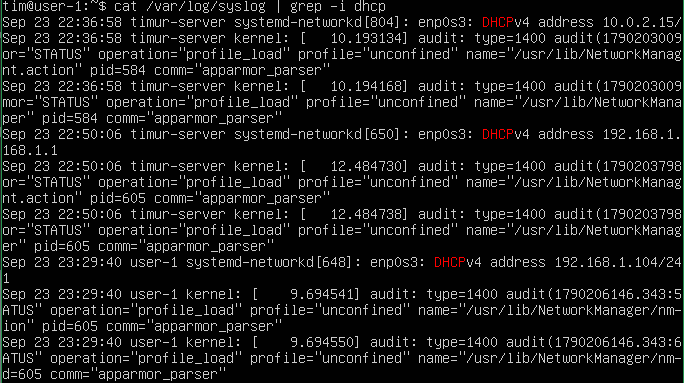
    
- На скриншоте видно, что DHCP выдал компьютеру ip адрес: 192.168.1.104/24

- Также ip адрес машины, выданный ей DHCP сервером, можно узнать с помощью команды: 
    ```
    ip r
    ```
    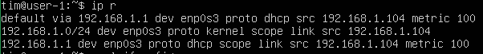

- >DHCP (Dynamic Host Configuration Protocol) - протокол динамической конфигурации хоста. Сетевой протокол, позволяющий устройствам автоматически получать IP-адрес и другие параметры, необходимые для работы в сети TCP/IP. Данный протокол работает по модели «клиент-сервер». Для автоматической конфигурации компьютер-клиент на этапе конфигурации сетевого устройства обращается к так называемому серверу DHCP и получает от него нужные параметры. IP-адрес (Internet Protocol) - способ адресации устройств по сети.

---
- Чтобы определить и вывести на экран внешний ip-адрес шлюза (ip) воспользуемся командой:
    ```
    curl ifconfig.co
    ```
    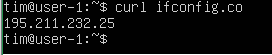


- Чтобы определить и вывести на экран внутренний IP-адрес шлюза, он же ip-адрес по умолчанию (gw), можно воспользоваться командами:
    ```
    ip route
    ```
    ```
    route -n
    ```
    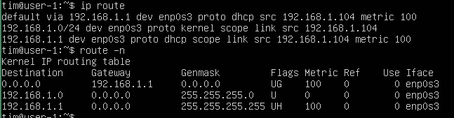
    
- Как видно из скриншотов, внешний IP-адрес шлюза: 195.211.232.25; а внутренний: 192.168.1.1.

---

- Зададим статичные (заданные вручную, а не полученные от DHCP сервера) настройки ip, gw, dns (используя публичные DNS серверы, например 1.1.1.1 или 8.8.8.8). DHCP автоматически присваивает устройству IP, поэтому сначала необходимо отключить облачную инициализацию. Нужно открыть файл конфигурации `subiquity-disable-cloudinit-networking.cfg` в каталоге `/etc/cloud/cloud.cfg.d/` с помощью команды:
```
sudo vim /etc/cloud/cloud.cfg.d/subiquity-disable-cloudinit-networking.cfg
```

- Необходимо, чтобы было: `config: disabled`

    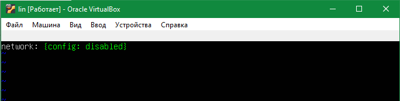

- Откроем файл конфигурации `netplan` в текстовом редакторе `vim` с помощью команды:
    ```
    sudo vim /etc/netplan/00-installer-config.yaml
    ```

    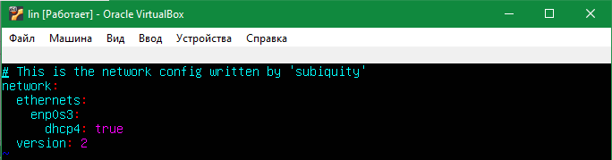

- Зададим статические настройки: изменим параметр dhcp4 на значение `false`, в `addresses` укажем статический IP-адрес: `192.168.1.104/24`, и в `gateway4` зададим внутренний IP-адрес `192.168.1.1`. В параметре `addresses` раздела `nameservers` укажем публичные серверы.

    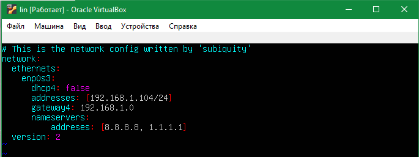

- Для применения изменений используем команду:
    ```
    sudo netplan apply
    ```

- Далее перезагрузим виртуальную машину командой `reboot` и проверяем сохранились ли выставленные вручную настройки (проверяем сохранились ли изменения в файле конфигурации). Для этого воспользуемся командой:
    ```
    cat /etc/netplan/00-installer-config.yaml
    ```

    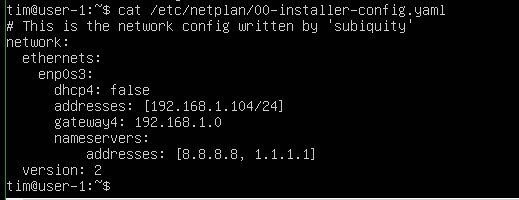

- Также, для проверки статического IP-адреса можно использовать команды:
    ```
    ip route show
    ```
    ```
    ifconfig
    ```

    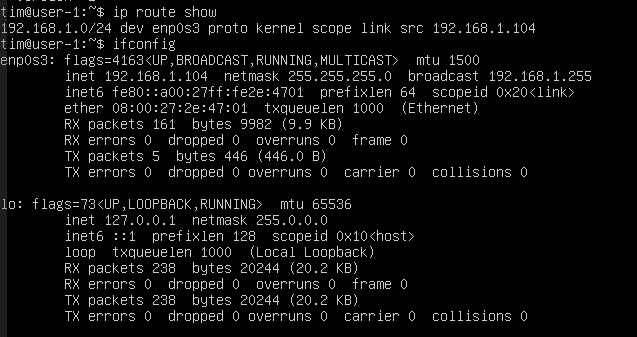

- На скриншотах видно, что выставленный вручную статический IP-адрес `192.168.1.104` после перезагрузки остался неизменным.

---

- Пропингуем удаленные хосты 1.1.1.1 и ya.ru с помощью команд:
    ```
    ping 1.1.1.1 -c 3
    ```
    ```
    ping ya.ru -c 3
    ```
    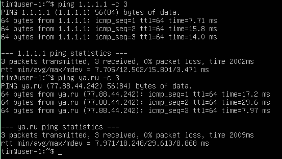

- На скриншоте видно, что выводе команды присутвствует фраза `0% packet loss`, это свидетельствует о том, что компьютер получил ответ от всех отправленных на указанные сервера пакетов данных.

- >Ping — утилита для проверки целостности и качества соединений в сетях. Утилита отправляет запросы указанному узлу сети и фиксирует поступающие ответы. Время между отправкой запроса и получением ответа позволяет определять двусторонние задержки по маршруту и частоту потери пакетов, то есть косвенно определять загруженность на каналах передачи данных и промежуточных устройствах.

## Part 4. Обновление ОС
- Для обновления индекса пакетов или списка пакетов, воспользуемся командой:
    ```
    sudo apt update
    ```
- Обновим системные пакеты до последней, на момент выполнения задания, версии, используя команду:
    ```
    sudo apt full-upgrade
    ```
    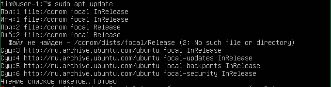

- После обновления системных пакетов видим, что при повторном введении двух последних команд получены сообщения об отсутствии новых обновлений
    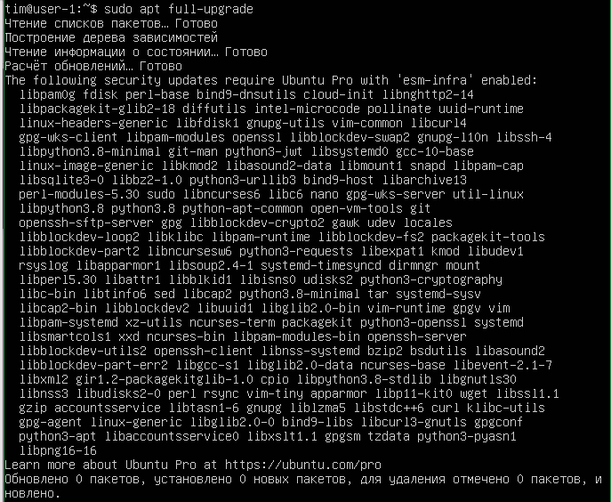


## Part 5. Использование команды **sudo**

- Разрешим пользователю, созданному в [Part 2](#part-2-создание-пользователя), выполнять команду sudo. Для этого необходимо добавить пользователя `newuser` в группу `sudo`. Воспользуемся командой:
    ```
    sudo usermod -a -G sudo newuser
    ```
- Проверим к каким группам принадлежит пользователь `newuser` с помощью команды:
    ```
    groups newuser
    ```

    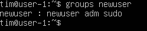

- На скриншоте видно, что пользователь был добавлен в группу `sudo`. Это дает ему возможность выполнять команду `sudo`.

- >Sudo (Substitute user and do - подменить пользователя и выполнить) – это утилита для операционных систем семейства Linux, позволяющая пользователю запускать программы с привилегиями другой учётной записи, как правило, суперпользователя.

- Поменяем hostname ОС от имени пользователя, созданного в пункте [Part 2](#part-2-создание-пользователя) (используя sudo). Для этого необходимо сменить текущего пользователя `lyjajerk` на ранее созданного `newuser` с помощью команды:
    ```
    su newuser
    ```

    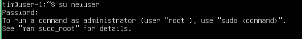

- Чтобы узнать текущее имя хоста воспользуемся командой:
    ```
    hostnamectl
    ```
- Изменим имя хоста с `user-1` на `user-2` с помощью команды:
    ```
    sudo hostnamectl set-hostname user-2
    ```
- Проверим изменения командой:
    ```
    hostname
    ```

    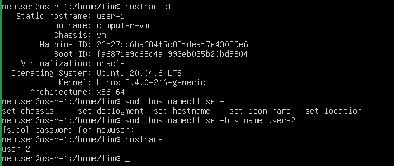

- Выполним перезагрузку машины командой `reboot` и проверим сохранность изменений:

    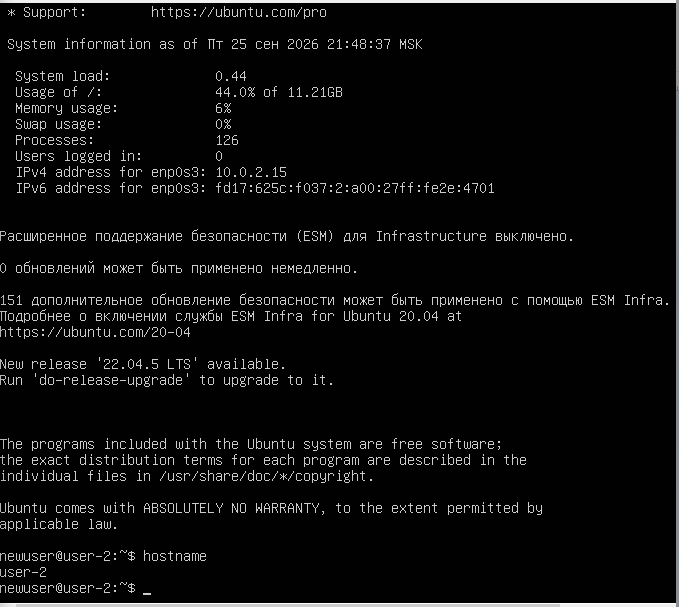

## Part 6. Установка и настройка службы времени

- С помощью команды `date` выведем текущее время часового пояса, в котором мы находимся.

- Для вывода настроек часового пояса, используем команду:
    ```
    timedatectl show
    ```

    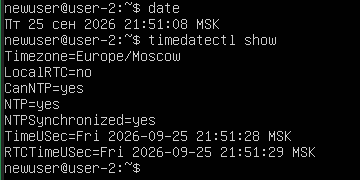

- >На скриншоте видно, что вывод команды `timedatectl show` содержит `NTPSynchronized=yes`, это соответствует требованию задания. Данная запись свидетельствует о том, что протокол NTP (сетевой протокол времени) активен. NTP - это протокол, отвечающий за синхронизацию времени компьютера со стандартными эталонными часами через интернет с помощью иерархии серверов NTP.

## Part 7. Установка и использование текстовых редакторов 

- Выполним установку текстовых редакторов командами:
    ```
    sudo apt install vim
    ```
    ```
    sudo apt install nano
    ```
    ```
    sudo apt install mcedit
    ```
---
### Запись никнейма в файлы и закрытие с сохранением

- VIM. Запишем никнейм `albussha` , перейдя в режим редактирования нажатием клавиши `i`:

    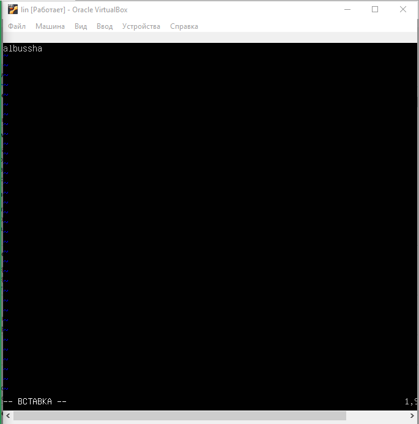

    - Для выхода с сохранением изменений нужно нажать `ESC`, затем написать `:wq`, что означает write and quit.

- NANO. Запишем никнейм `albussha`:

    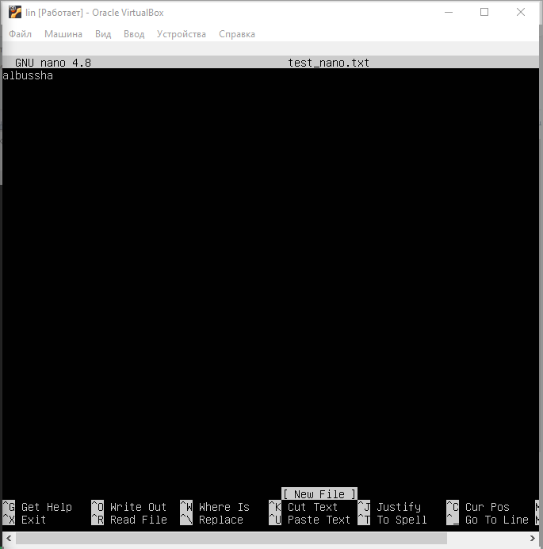

    - Для выхода с сохранением изменений нужно нажать `Ctrl+S` и затем `Ctrl+X`.

- MCEDIT. Запишем никнейм `albussha`:

    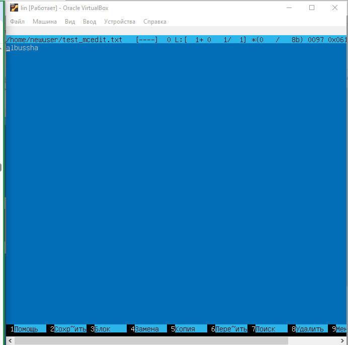

    - Для выхода с сохранением изменений нужно нажать `F10` и выбрать `Yes`

    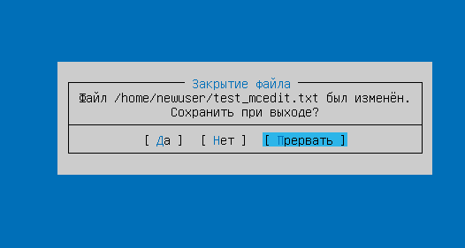

---
### Запись "21 School 21" в файлы с выходом без сохранения

- VIM. Запишем "21 School 21":

    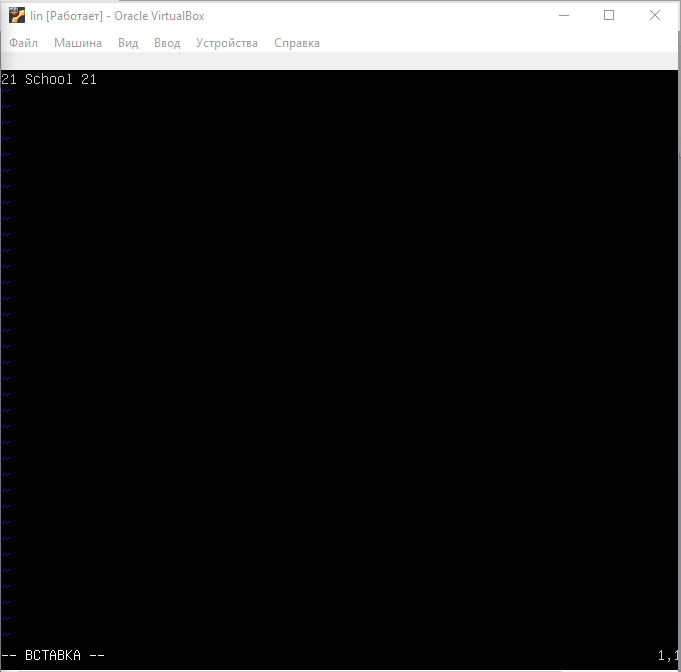

    - Для выхода без сохранения нужно нажать `ESC`, затем написать `:q!`. Проверим, что изменения не сохранились:

    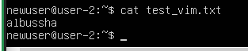

- NANO. Запишем "21 School 21":

    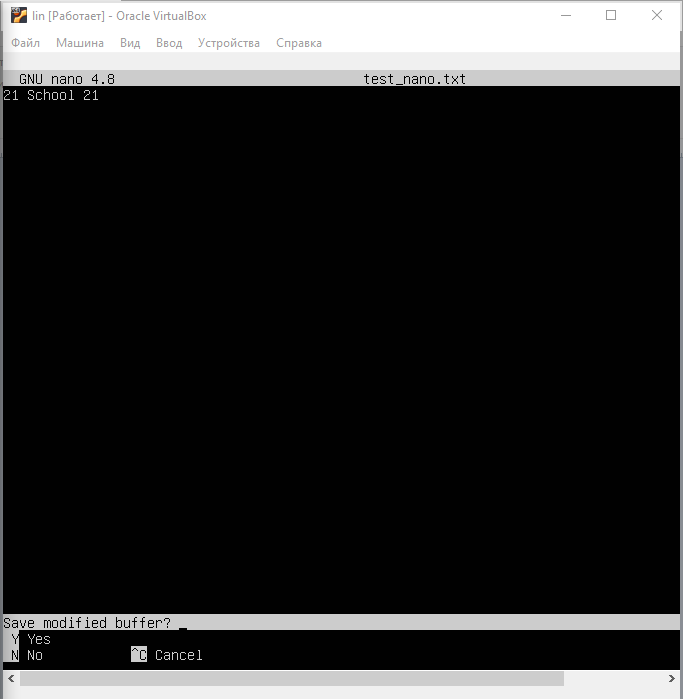

    - Для выхода без сохранения изменений нужно нажать `Ctrl+X` и подтвердить нажатием на `N`. Проверим, что изменения не сохранились:

    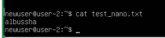

- MCEDIT. Запишем "21 School 21":

    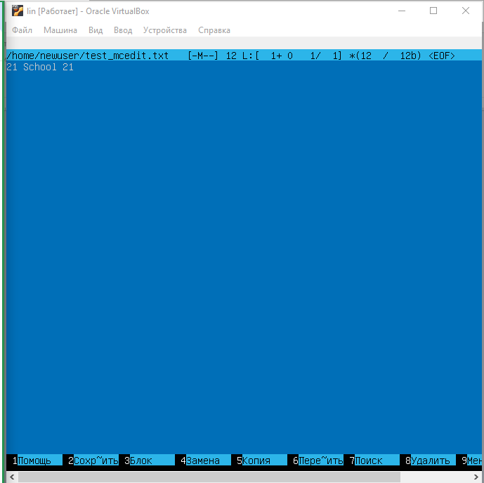

    - Для выхода без сохранения изменений нужно нажать `F10` и выбрать `No`

    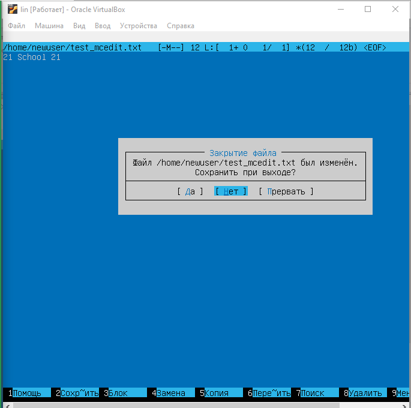

    - Проверим, что изменения не сохранились:

    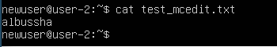

---


### Поиск по слову в файлах
- Внесем изменения с предыдущего пункта (запишем в файлы "21 School 21") и сохраним их.

- **VIM**

    - Поиск:
    `ESC + /<слово_для_поиска>`
    
    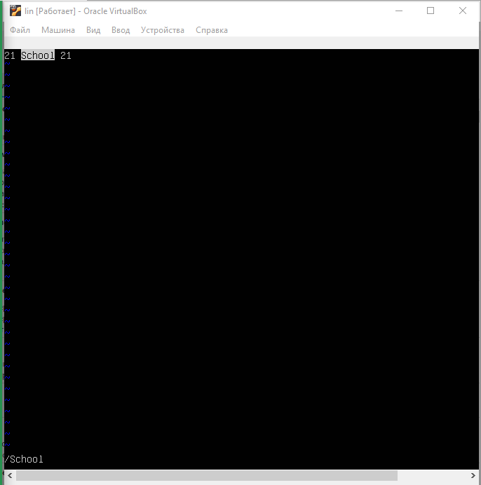

    - Замена:
    `:s/<заменяемое>/<заменитель>`

    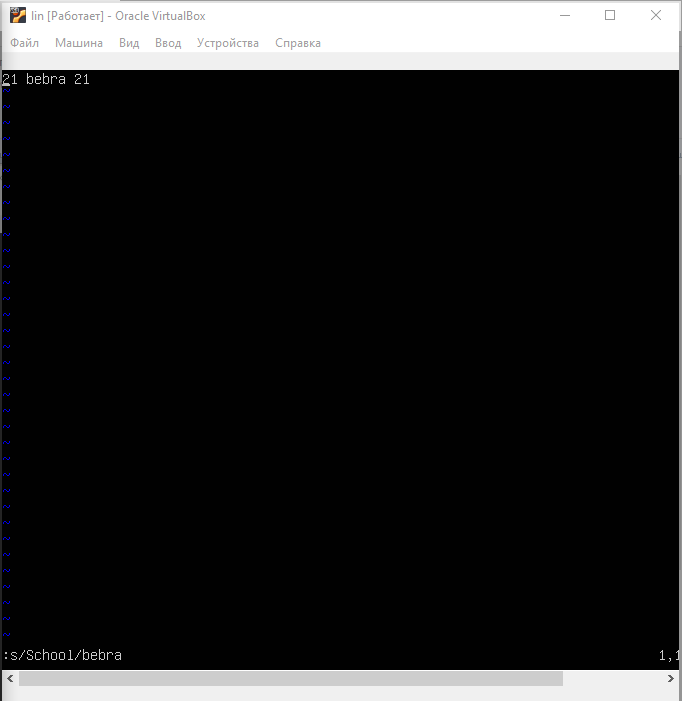

- **NANO**

    - Поиск:
    `Ctrl + W`
    
    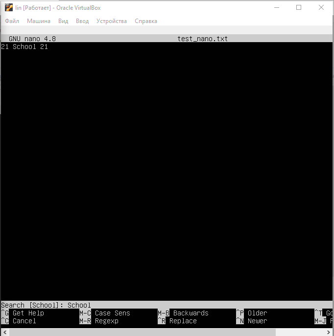

    - Замена:
    `Ctrl + \`

    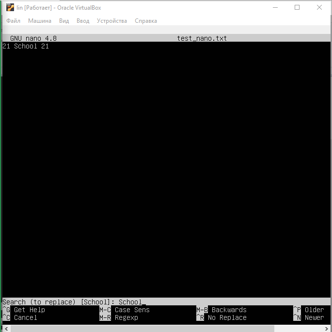

    - Вводим слово для замены:

    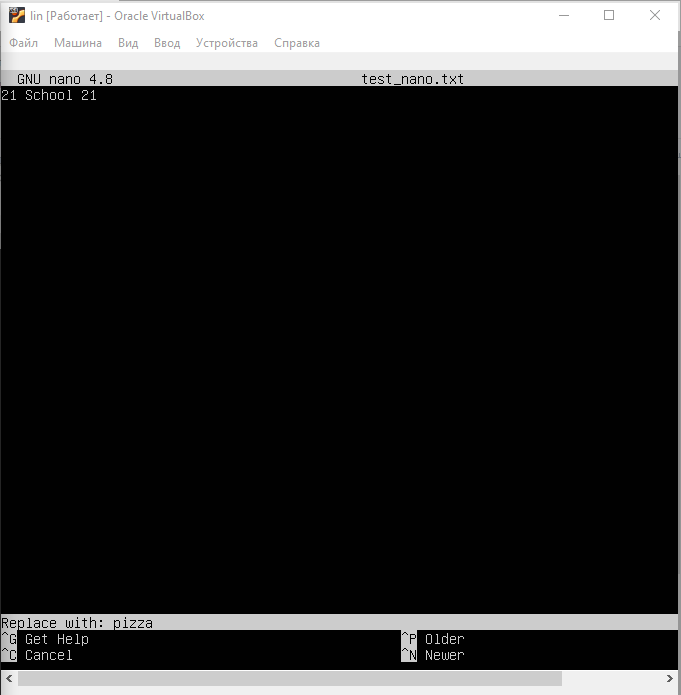

    - Применяем замену:

    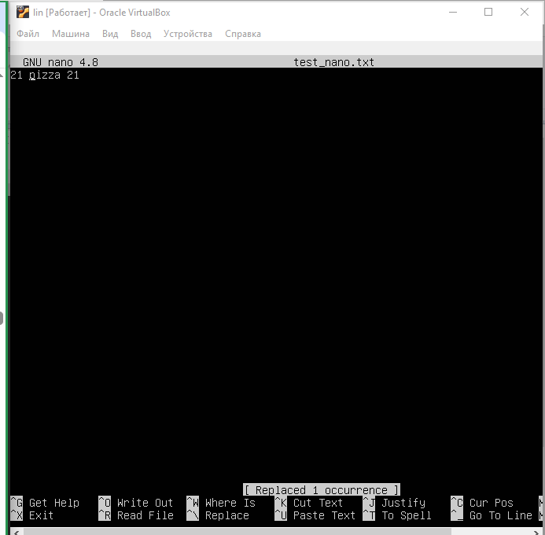

- **MCEDIT**

    - Поиск:
    `F7`
    
    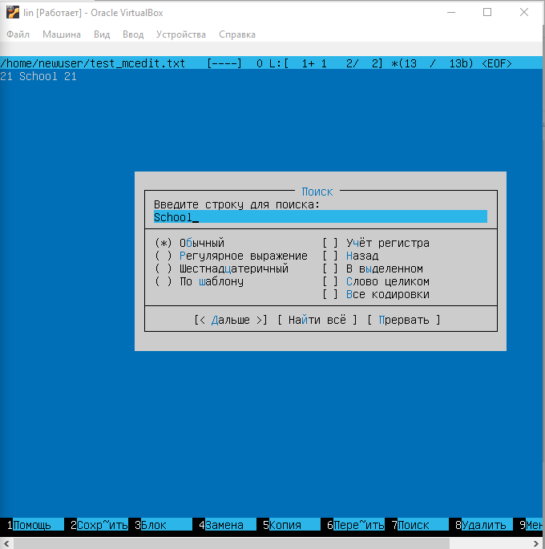

    - Вводим и подтверждаем слово для поиска:

    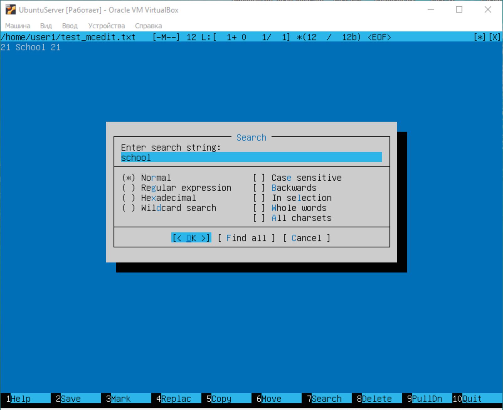

    - Замена:
    `F4`

    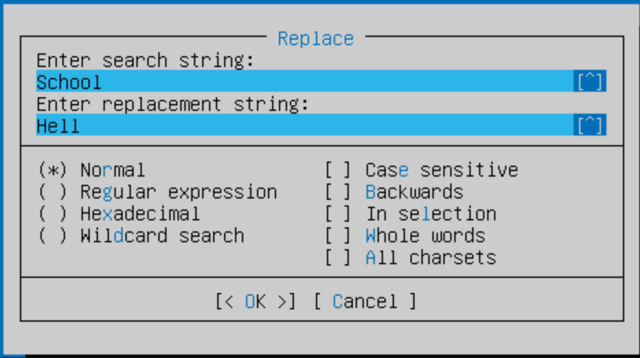

    - Вводим и подтверждаем слово для замены:

    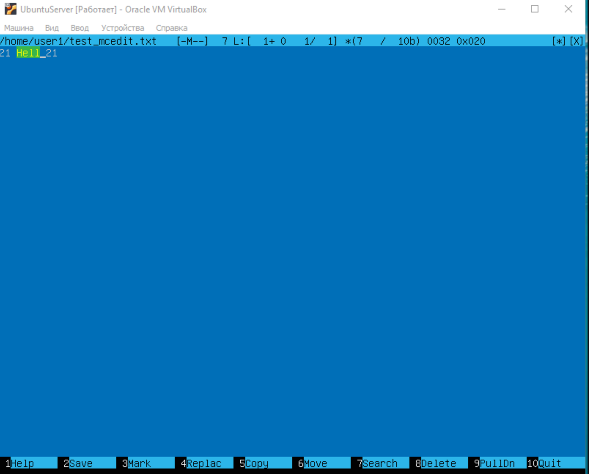

## Part 8. Установка и базовая настройка сервиса **SSHD**

- Установим службу SSHd с помощью команды:
    ```
    sudo apt install openssh-server
    ```

- Узнаем состояние SSHd службы, воспользовавшись командой:
    ```
    sudo systemctl status ssh
    ```

    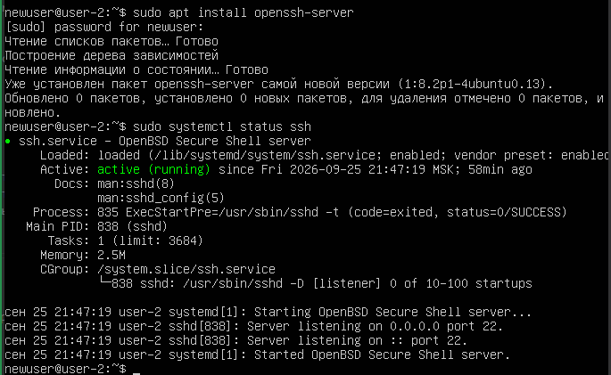

- Как видно на скриншоте, автостарт SSHd службы добавлен автоматически при загрузке. Чтобы включить автостарт можно воспользоваться командой `sudo systemctl enable ssh`, для выключения автостарта команда `sudo systemctl disable ssh`.

- Для перенастройки службы SSHd на порт 2022 откроем файл `sshd_config` с помощью команды:
    ```
    sudo nano /etc/ssh/sshd_config
    ```
- Изменим значение параметра `Port` с 22 на 2022

    

- Чтобы изменения в конфигурации сохранились, перезапустим сервер OpenSSH, используя следующую команду:
    ```
    sudo systemctl restart ssh 
    ```

- Проверим состояние SSHd службы после изменения порта командой `sudo systemctl status ssh`

    

    - На скриншоте видно, что порт изменен.

- Настроим брандмауэр, так как мы изменили SSH-порт по умолчанию на 2022. 
    - Заменим “ssh” новым номером порта: 
    `sudo ufw allow 2022/tcp`

    

- Покажем наличие процесса sshd, используя команду:
    ```
    ps aux | grep -i ssh
    ```

    

    - > **ps** - утилита для просмотра списка процессов в Linux. <br> Параметр `-a` - выбрать все процессы всех пользователей, кроме фоновых. 
    <br> Параметр `-u` обозначает ориентированный на пользователя формат, который предоставляет подробную информацию о процессах. 
    <br> Параметр `-x` указывает `ps` перечислить процессы без управляющего терминала.
    <br> В основном это процессы, которые запускаются во время загрузки и работают в фоновом режиме.
    <br> `grep -i ssh` - выводит только те строчки, где есть ssh с игнорированием регистра за счет `-i`.
    <br> Символ `|` перенаправляет вывод команды `ps aux` на ввод `grep -i ssh`.

- Выполним перезагрузку машины командой `reboot` и выполним команду:
    ```
    netstat -tan
    ```

    

    - Как видно на скриншоте, вывод команды содержит `tcp 0 0 0.0.0.0:2022 0.0.0.0:* LISTEN`, что соответствует требованию задания.

    - >`netstat -tan`\
    \
    Команда `netstat` показывает статистику приема и отправки пакетов, а также информацию об ошибках приема и отправки.\
    \
    `-a` - Вывод всех активных подключений TCP и прослушиваемых компьютером портов TCP и UDP.\
    `-n` - Вывод активных подключений TCP с отображением адресов и номеров портов в числовом формате без попыток определения имен.\
    Тогда, если `netstat -na` - просмотр всех открытых протоколов, то `netstat -tan` - просмотр всех открытых ТСР-протоколов.\
    \
    При вызове команды в терминал выводится таблица, столбцы которой имеют следующие значения:\
    а) `Proto` - сетевой протокол (tcp, udp);\
    б) `Recv-Q` - количество байтов, помещённых в буфер приёма TCP/IP, но не переданных приложению. Если это число высокое, то нужно проверить работоспособность приложения, которое работает с данным портом.\
    в) `Send-Q` — количество байтов, помещённых в буфер отправки TCP/IP, но не отправленных, или отправленных, но не подтверждённых. Высокое значение может быть связано с перегрузкой сети сервера.\
    г) `Local Address` — локальный адрес сервера. В обычных соединениях, это адрес сервера на который пришло соединение. В прослушиваемых портах (LISTEN) — это диапазон адресов. Так 0.0.0.0:port — значит подключаться можно ко всем адресам сервера, а 192.168.0.35:port — значит подключаться можно только к этому адресу сервера.\
    д) `Foreign Address` — адрес второй стороны. В обычных соединениях, это адрес с которого пришло соединение. В прослушиваемых портах (LISTEN) — это диапазон адресов. Так 0.0.0.0:* — значит подключаться можно с любых адресов и с любых портов, а например 192.168.0.50:* — значит подключаться можно только с этого адреса и с любых портов.\
    е) `State` — состояние подключения, или прослушивания.


## Part 9. Установка и использование утилит **top**, **htop**
- Команда `top` выводит на экран:

    

  - uptime - 34 минуты;
  - количество авторизованных пользователей - 1;
  - общую загрузку системы - 0.00;
  - общее количество процессов - 113;
  - загрузка cpu - 0.0 %;
  - загрузка памяти - 178.6 из 3167.1;
  - pid процесса занимающего больше всего памяти - 1;
  - pid процесса, занимающего больше всего процессорного времени - 1609 и 2001 <br>
  (2 процесса занимают одинаковое процессорное время).

- **htop** :
    - Вывод команды без сортировки

    

    - Для сортировки в `htop` нужно нажать `F6` и выбрать параметр сортировки.
    - `htop` отсортированный по `PID`

    

    - `htop` отсортированный по `PERCENT_CPU`

    

    - `htop` отсортированный по `PERCENT_MEM`

    

    - `htop` отсортированный по `TIME`

    

    - Для использования фильтров в `htop` нужно нажать `F4` и выбрать параметр фильтрации.
    - htop, отфильтрованный для процесса SSHd

    

    - Для использования поиска в `htop` нужно нажать `F3` и ввести объект поиска. <br>
    `htop` с процессом `syslog`, найденным, используя поиск:

    

    - Для добавления отображения дополнительных параметров в `htop`, необходимо нажать `F2` и добавить требуемые параметры. `htop` с добавленным выводом hostname, clock и uptime

    

## Part 10. Использование утилиты **fdisk**

##### Запустить команду fdisk -l.

- Выполним команду:
    ```
    fdisk -l
    ```
    

    - Название жесткого диска: VBOX HARDDISK (/dev/sda);
    - Размер диска: 25 Гигабайт;
    - Количество секторов: 52428800;

- Чтобы узнать размер `swap` выполним команду:
    ```
    free -h
    ```
    

- Второй способ узнать размер `swap`:
    ```
    swapon -s
    ```
    

- Выяснилось, что:
    - Размер swap: 2344956 килобайта (= 2.34 Гб);

## Part 11. Использование утилиты **df** 

- Выполним команду:
    ```
    df /
    ```

    

    >Для корневого раздела (/):\
        - Размер раздела: 11758760;\
        - Размер занятого пространства: 5220276;\
        - Размер свободного пространства: 5919376;\
        - Процент использования: 47 %;\
        Единицы измерения при выводе: Килобайты.

- Выполним команду:
    ```
    df -Th
    ```

    

    >Для корневого раздела (/):\
        - Размер раздела: 12;\
        - Размер занятого пространства: 5.0;\
        - Размер свободного пространства: 5.7;\
        - Процент использования: 47 %;\
        Единицы измерения при выводе: Гигабайты.

    Тип файловой системы: `Ext4` - журналируемая файловая система, используемая в ОС на ядре Linux. Основана на файловой системе Ext3, но отличается тем, что в ней представлен механизм записи файлов в непрерывные участки блоков (екстенты), уменьшающий фрагментацию и повышающий производительность. В ней есть журналирование, то есть в ней предусмотрена запись некоторых данных, позволяющих восстановить файловую систему при сбоях в работе компьютера.

## Part 12. Использование утилиты **du**

- Выполним команду:
    ```
    du
    ```

    

- Вывод размера папки /home в байтах и в человекочитаемом виде командами:
    ```
    sudo du -s /home/
    ```
    ```
    sudo du -sh /home/
    ```

    

- Вывод размера папки /var в байтах и в человекочитаемом виде командами:
    ```
    sudo du -s /var/
    ```
    ```
    sudo du -sh /var/
    ```

    

- Вывод размера папки /var/log в байтах и в человекочитаемом виде командами:
    ```
    sudo du -s /var/log/
    ```
    ```
    sudo du -sh /var/log/
    ```

    

- Вывод размера всего содержимого папки /var/log в байтах и в человекочитаемом виде командами:
    ```
    sudo du /var/log/
    ```
    ```
    sudo du -h /var/log/
    ```

    

- Вывод размера всего содержимого папки (каждого вложенного элемента) /var/log с использованием `*` командой:
    ```
    sudo du /var/log/* | less
    ```

    

## Part 13. Установка и использование утилиты **ncdu**

- Установим утилиту `ncdu` командой:
    ```
    sudo apt install ncdu
    ```
    

- Выведем размер папки `/home`:

    

- Выведем размер папки `/var`:

    

- Выведем размер папки `/var/log`:

    

- На скриншотах видно, размеры папок примерно совпадают с полученными в `части 12` [Part 12] задания.

## Part 14. Работа с системными журналами

- `/var/log/dmesg` — драйвера устройств. Содержит сообщения, полученные от ядра. Регистрирует много сообщений еще на этапе загрузки, в них отображается информация об аппаратных устройствах, которые инициализируются в процессе загрузки. Одноименной командой можно просмотреть вывод содержимого файла. Размер журнала ограничен, когда файл достигнет своего предела, старые сообщения будут перезаписаны более новыми. Откроем для просмотра файл `/var/log/dmesg` с помощью команды:
    ```
    less /var/log/dmesg
    ```

    

- `/var/log/syslog` — содержит глобальный системный журнал, в котором пишутся сообщения с момента запуска системы, от ядра Linux, различных служб, обнаруженных устройствах, сетевых интерфейсов и много другого. Откроем для просмотра файл `/var/log/syslog` с помощью команды:
    ```
    less /var/log/syslog
    ```

    

- `/var/log/auth.log` — информация об авторизации пользователей, включая удачные и неудачные попытки входа в систему, а также задействованные механизмы аутентификации. Откроем для просмотра файл `/var/log/auth.log` с помощью команды:
    ```
    less /var/log/auth.log
    ```

    

- Время последней успешной авторизации: sep 23, 22:38:09
- Имя пользователя: newuser
- Метод входа в систему: by uid = 0 (User Identifier). Суперпользователь всегда должен иметь UID, равный нулю (0).

- Перезапустим службу SSHd с помощью команды:
    ```
    sudo systemctl restart ssh
    ```
- В журнале найдем сообщение о перезапуске службы:

    

## Part 15. Использование планировщика заданий **CRON**

- Запустим команду `uptime` через каждые 2 минуты. Для этого откроем планировщик заданий `CRON` в текстовом редакторе `nano` с помощью команды:
```
crontab -e
```
- Добавим строчку `*/2 * * * * uptime`

    

- После чего сохраним и закроем файл.
- Найдем в системных журналах строчки о выполнении `uptime`. Для этого воспользуемся командой:
    ```
    less /var/log/syslog | grep CRON
    ```

    

- Выведем на экран список текущих заданий для `CRON` с помощью команды:
    ```
    crontab -l
    ```

    

- Удалим все задания из планировщика заданий `CRON` с помощью команды:
    ```
    crontab -r
    ```
- Проверим список текщих задач после удаления командой `crontab -l`:

    